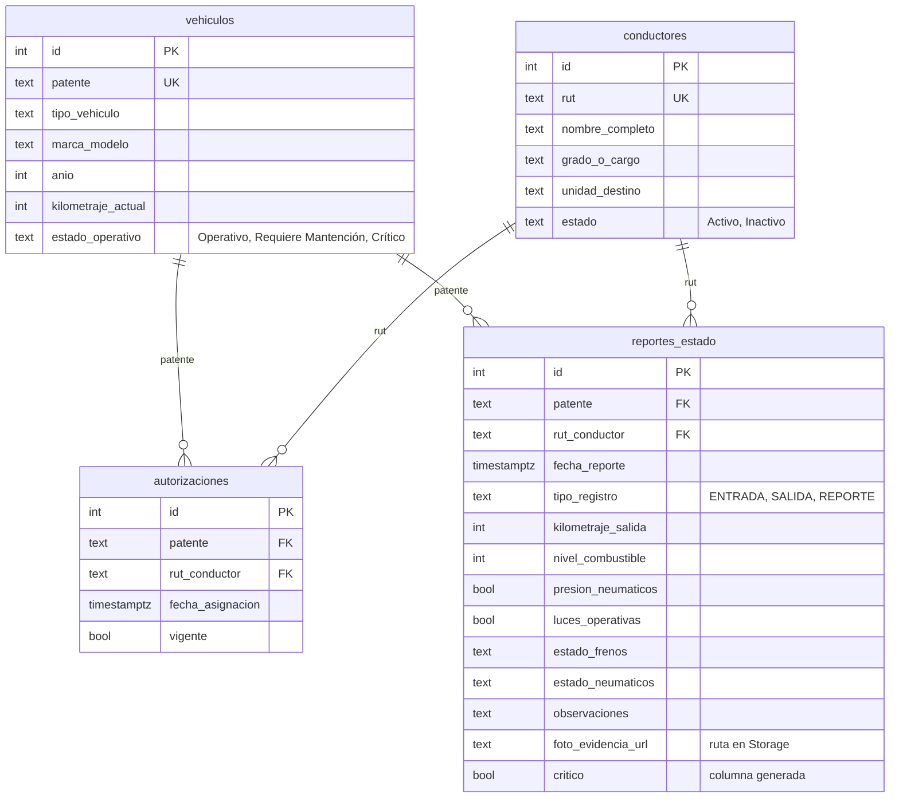
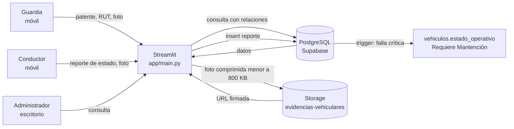
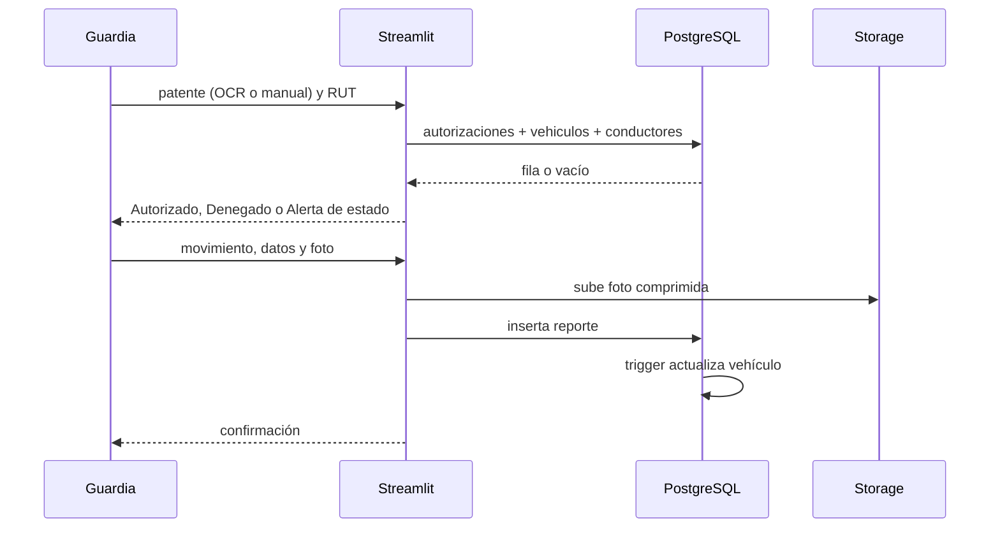

# Informe técnico: gestión de flota y control de acceso vehicular

Programación avanzada, Sesión 12. Aplicación y desafíos operacionales.

## 1. Resumen

Se implementó una aplicación modular en Python y Streamlit, conectada a Supabase (PostgreSQL y Storage), que digitaliza el registro en guardia y el reporte de estado de la flota. Opera con tres perfiles, sin contraseñas: Guardia de Garita, Conductor Operativo y Administrador de Puesto de Mando.

## 2. Decisiones de arquitectura

| Decisión | Justificación |
|---|---|
| Streamlit como interfaz única | Una sola base de código en Python sirve la vista móvil (guardia y conductor) y el panel de escritorio. `st.camera_input` permite fotografiar desde el navegador del teléfono. |
| Supabase (PostgreSQL y Storage) | Base relacional con integridad referencial y almacenamiento de objetos en un solo servicio, sin servidor propio. |
| Lógica crítica dentro de la base de datos | La regla "falla crítica implica Requiere Mantención" es un trigger SQL. Se cumple sin importar qué cliente inserte el reporte y no depende de que la interfaz la recuerde. |
| Una consulta con relaciones para validar acceso | Reduce tres consultas a una y evita estados intermedios inconsistentes (ver sección 5.1). |
| Bucket privado y URLs firmadas | Las fotos de un recinto militar no deben ser públicas. La app genera URLs temporales (1 hora) solo para el perfil que las necesita. |
| Compresión de fotos en el servidor | Cada imagen se redimensiona (máximo 1920 px) y se recomprime a JPEG hasta quedar bajo 800 KB. El bucket además rechaza archivos mayores (`file_size_limit`). |
| Credenciales en `.streamlit/secrets.toml` | El archivo está en `.gitignore`; el repositorio solo contiene `secrets.toml.example`. |
| Row Level Security sin políticas | Las tablas tienen RLS activo sin políticas: las llaves públicas no leen ni escriben. Solo el servidor Streamlit, con la llave secreta, accede. |
| Módulos pequeños por perfil | `guardia.py`, `conductor.py` y `puesto_mando.py` son independientes; comparten solo `reportes.py` y `utilidades.py`. |

## 3. Modelo de datos



Restricciones de integridad: llaves primarias, `unique` en patente y RUT, llaves foráneas con `on update cascade`, `check` sobre estados, kilometraje no negativo y combustible entre 0 y 100, y `unique (patente, rut_conductor)` en autorizaciones.

Relación con la guía: la guía nombra la tabla "autorizaciones_acceso" en la Sección A y "autorizaciones" en la lista de activos y en los datos entregados. Se usó `autorizaciones`, que coincide con los CSV.

Catálogo cargado: 15 vehículos, 30 conductores, 18 autorizaciones y 2 reportes históricos.

## 4. Flujo de datos





## 5. Respuestas a las preguntas de la guía

### 5.1 ¿Cómo se estructuró la consulta para validar conductor y vehículo a la vez?

La consulta parte de `autorizaciones`, que ya relaciona patente y RUT, e incorpora por llave foránea el vehículo y el conductor:

```python
supabase.table("autorizaciones")
    .select("*, vehiculos(*), conductores(*)")
    .eq("patente", patente).eq("rut_conductor", rut).eq("vigente", True)
```

Equivale a un `JOIN` entre las tres tablas en una sola ida a la base. Si devuelve una fila, existe autorización vigente y la misma respuesta trae el estado del conductor y el estado operativo del vehículo. Con eso la resolución es:

| Condición | Resolución |
|---|---|
| Sin fila, patente inexistente | Denegado: patente no registrada |
| Sin fila, RUT inexistente | Denegado: RUT no registrado |
| Sin fila, ambos existen | Denegado: sin autorización vigente |
| Conductor no activo | Denegado |
| Vehículo Crítico | Denegado |
| Vehículo Requiere Mantención | Alerta de estado (puede registrarse el movimiento) |
| Vehículo Operativo | Autorizado |

Solo cuando la consulta no devuelve filas se hacen consultas adicionales, para indicar al guardia qué elemento falla.

### 5.2 ¿Qué lógica automatizada pasa el vehículo a Requiere Mantención?

Es un trigger de PostgreSQL (`trg_aplicar_reporte`, en `database/schema.sql`) que se ejecuta después de cada `insert` en `reportes_estado`. La columna `critico` de la tabla es generada: vale verdadero si `estado_frenos = 'Con falla'` o `estado_neumaticos = 'Baja presión severa'`. Si el reporte es crítico y el vehículo está Operativo, el trigger lo cambia a `Requiere Mantención`. Un vehículo ya Crítico no se modifica. El trigger también avanza `kilometraje_actual` al mayor valor informado.

Al estar en la base, la regla se aplica aunque el reporte llegue desde otra herramienta. La aplicación, tras guardar, vuelve a leer el vehículo y muestra al conductor el estado resultante.

### 5.3 Gestión de sesión y perfiles

- La aplicación no pide contraseñas: al abrirla, `main.py` muestra una pantalla con tres botones, uno por perfil.
- El perfil elegido se guarda en `st.session_state["perfil"]`, el estado de sesión de Streamlit. Persiste entre interacciones del mismo navegador y se pierde al cerrar la pestaña o al pulsar Cambiar perfil.
- La navegación es condicional: un diccionario asocia cada perfil con la función que dibuja su vista (`perfil_guardia`, `perfil_conductor`, `perfil_puesto_mando`) y solo se ejecuta la del perfil activo. La barra lateral muestra el perfil activo y el botón para cambiarlo.
- El conductor se identifica con su RUT, que se valida contra la tabla `conductores`; solo ve y reporta los vehículos con autorización vigente para ese RUT.

Limitación: la selección de perfil no es un control de acceso, por diseño de la actividad. En un despliegue real convendría autenticar con Supabase Auth y limitar los datos con RLS por rol.

## 6. Panel BI (perfil Administrador)

- Indicadores: vehículos en flota, disponibilidad porcentual, unidades inmovilizadas o en mantención (se desglosa en Críticas y Requiere Mantención) y accesos registrados.
- Matriz de estado por vehículo con colores: verde (Operativo), amarillo (Requiere Mantención), rojo (Crítico).
- Listado de alertas: vehículos con estado no operativo o con falla de frenos, neumáticos o luces en su último reporte.
- Analítica: kilometraje acumulado por vehículo, frecuencia de accesos por unidad táctica o por vehículo, con filtro por entrada o salida, y combustible promedio reportado.
- Feed cronológico de accesos con la fotografía de evidencia cargada desde Storage.
- Auditoría: se elige una patente, se ve su ficha técnica y el historial de reportes con fotografías, con filtro de reportes críticos o con novedades.
- Los datos se refrescan solos cada 30 segundos (`st.fragment(run_every=30)`).

## 7. Validación

Las pruebas se hicieron contra un proyecto propio de Supabase, con el esquema de `database/schema.sql` y los datos de `data/`.

| Prueba | Resultado |
|---|---|
| Carga de datos | 15 vehículos, 30 conductores, 18 autorizaciones y 2 reportes históricos |
| Bucket `evidencias-vehiculares` | Privado, con límite de 800 KB: subir un archivo mayor devuelve "Payload too large" |
| URL firmada de una evidencia | Se genera y la imagen se muestra en el panel |
| Reporte con frenos con falla (EFGH-34, Operativo) | El trigger cambió el vehículo a Requiere Mantención y avanzó el kilometraje. Luego se restauró el dato de prueba |
| Guardia: JKLM-56 con 16.111.999-8 | Autorizado (captura 5) |
| Guardia: ABCD-12 con 18.234.567-K | Alerta de estado, el vehículo requiere mantención |
| Guardia: EFGH-34 con un RUT sin autorización | Denegado |
| Guardia: patente inexistente | Denegado |
| Conductor 18.234.567-K | Ve ABCD-12 y NPQR-78, sus vehículos autorizados |
| Foto de 26 MB | Se comprime a 643 KB, bajo el límite |
| Reporte sin foto | Se rechaza |
| Panel del administrador | 15 vehículos, 66,7% de disponibilidad, 5 inmovilizadas o en mantención (capturas 1 a 4) |

Capturas del sistema, en `docs/capturas/`:

1. `01_panel_estado_flota.jpg`: indicadores y matriz de colores por vehículo.
2. `02_panel_uso_consumo.jpg`: kilometraje acumulado por vehículo y estado.
3. `03_panel_feed_accesos.jpg`: feed cronológico de accesos con evidencia fotográfica.
4. `04_panel_auditoria.jpg`: auditoría de RRSS-34, con reporte crítico y foto.
5. `05_guardia_movil_autorizado.jpg`: vista móvil del guardia con acceso autorizado.

Nota sobre los datos de demostración: para poblar el feed y la auditoría se cargaron 6 registros de prueba (entradas, salidas y reportes) con imágenes generadas, marcadas como "FOTO DE PRUEBA". El reporte de RRSS-34 es crítico (frenos con falla), por lo que ese vehículo quedó en Requiere Mantención. La cámara no se probó porque el navegador usado para las capturas la bloquea; el envío de fotos se verificó por subida directa a Storage.
